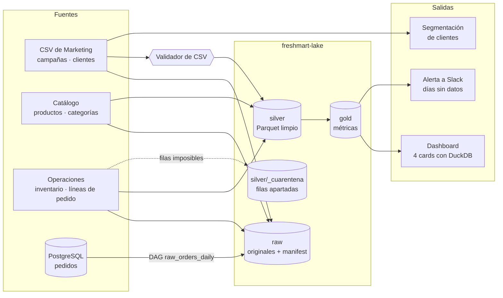

# FreshMart

Pipeline de datos para un supermercado online ficticio, hecho como proyecto de portfolio de
Data Engineering.

## ¿Qué hace?

FreshMart recibe datos de varios equipos: CSV de campañas de Marketing, el catálogo de
productos, el inventario diario de las tiendas y los pedidos de la base de datos de la tienda
online. Este proyecto los lleva a un data lake ordenado por capas para que se puedan consultar
con confianza.

- **raw**: copia exacta de cada archivo, sin tocar, con un manifest que registra su huella
  (sha256). Si se vuelve a subir lo mismo, no cambia nada.
- **silver**: los datos limpios y validados en Parquet. Cada campaña trae su propio formato
  (nombres de columna, fechas, precios), y una configuración por campaña lo lleva todo al mismo
  esquema. Si falla una validación de tabla, no se escribe nada. Las filas imposibles, como un
  stock negativo o un total que no cuadra, no se borran: se apartan a una cuarentena con el
  motivo.
- **gold**: las métricas que usa negocio, como el rendimiento diario de cada campaña, los
  productos más vendidos o el estado del stock por tienda. Cada métrica se calcula en pandas y
  en SQL, y un test comprueba que los dos resultados coinciden.

Alrededor del pipeline hay un validador que revisa los CSV antes de procesarlos, una alerta a
Slack cuando falta algún día en gold y tres DAGs de Airflow que lo ejecutan todo de forma
programada.

## Cómo ejecutarlo

Necesitas Python 3.11 o superior. Los CSV del caso van en `data/` (no están en el repositorio).

```powershell
git clone https://github.com/josuehormigabenitez22-cmd/FreshMart-OSupermarket-Proyect.git
cd FreshMart-OSupermarket-Proyect
python -m venv .venv
.\.venv\Scripts\Activate.ps1        # en macOS/Linux: source .venv/bin/activate
python -m pip install -e ".[dev]"
```

Con el entorno activado, este es el orden para montar el lake completo:

```powershell
# 1. Copiar los CSV a raw
python scripts/subir_a_raw.py

# 2. Catálogo a silver (lo necesitan gold, el inventario y las líneas de pedido)
python scripts/ejecutar_pipeline.py --catalog --input data --silver-dir freshmart-lake/silver

# 3. Campañas a silver y después gold
python scripts/ejecutar_pipeline.py --all --input data --silver-dir freshmart-lake/silver --gold-dir freshmart-lake/gold

# 4. Inventario y líneas de pedido
python -m freshmart.inventory.cli --input data --silver-dir freshmart-lake/silver --gold-dir freshmart-lake/gold
python -m freshmart.orders.lineas --input data --silver-dir freshmart-lake/silver

# 5. Consultar los resultados
python scripts/dashboard.py --gold-dir freshmart-lake/gold --input data
python scripts/segmentar.py --verify
```

Otros comandos útiles:

```powershell
python scripts/validar_csv.py data/campana_verano_ventas.csv --campaign verano
python -m freshmart.quality.gap_detection --gold-dir freshmart-lake/gold --campaign verano
pytest                  # todos los tests
ruff check . ; mypy     # lint y tipos
```

Si tienes `make` (Linux, macOS o Git Bash), `make pipeline`, `make test` y `make check` hacen lo
mismo. Las rutas y el webhook de Slack se pueden cambiar con las variables de `.env.example`.

## Cómo funciona



Tres DAGs de Airflow lo ejecutan de forma programada:

| DAG | Cuándo | Qué hace |
|---|---|---|
| `raw_orders_daily` | cada día a las 03:00 | Copia los pedidos del día anterior de PostgreSQL a raw |
| `operations_daily` | cada día a las 05:00 | Catálogo, inventario y líneas de pedido |
| `campaign_pipeline_weekly` | los lunes a las 06:00 | Valida los CSV de campaña, construye silver y gold y busca días sin datos |

Los DAGs no guardan credenciales: la conexión a PostgreSQL es una Connection de Airflow y las
rutas son Variables. Toda la lógica está en `src/freshmart/` y se puede probar sin Airflow.

Para entrar en detalle: [diccionario de datos](docs/data_dictionary.md),
[decisiones técnicas](docs/decisions/)
y [cómo añadir una campaña](docs/playbook_nueva_campana.md).

## Licencia

Este proyecto **no es open source**. Es un proyecto de portfolio con todos los derechos
reservados: puedes ver el código para evaluarlo, pero no copiarlo, modificarlo, redistribuirlo
ni usarlo comercialmente sin permiso por escrito. Los detalles están en [LICENSE](LICENSE).

FreshMart es un escenario ficticio y los datos son material de práctica.

## Autor

**Josué Hormiga Benítez**

- LinkedIn: [Josué Juan Hormiga Benítez](https://www.linkedin.com/in/josu%C3%A9-juan-hormiga-ben%C3%ADtez-098499334/)
- GitHub: [@josuehormigabenitez22-cmd](https://github.com/josuehormigabenitez22-cmd)
- Repositorio: [FreshMart-OSupermarket-Proyect](https://github.com/josuehormigabenitez22-cmd/FreshMart-OSupermarket-Proyect)
